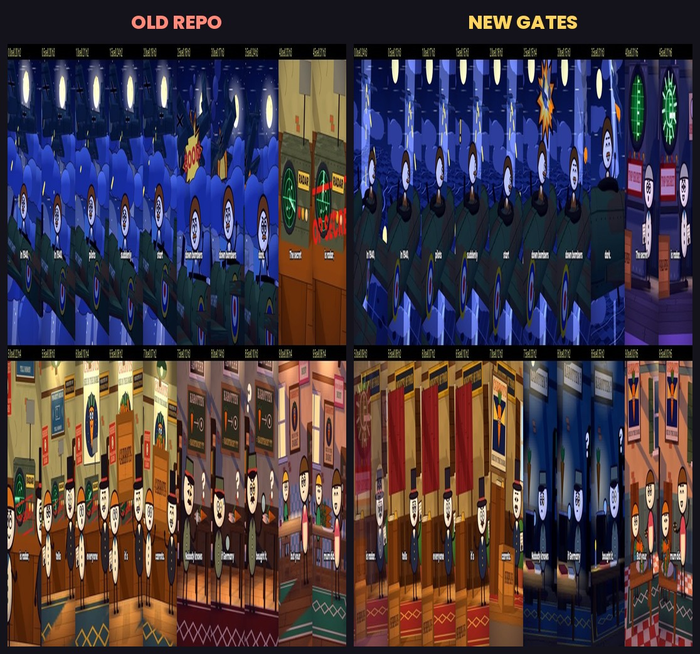

# Do the gates help? One 10-second film, made with and without them

Two agents were given the same script, the same voice track and the same brief ("follow SKILL.md, at most 30 stills,
stop when it is fit to show"), each in its own copy of the repo: one at the commit before the gates in `docs/gates.md`
(old), one with them (new). Both films were rendered the same way and reviewed by two independent reviewers who did
not know which was which. The new film is kept as `studio/src/videos/carrots/`.

This is one film per arm. Treat the numbers as an indication, not a measurement with error bars. A second pair was
planned and dropped when the session hit a usage limit.

## Result

| | Old repo | New gates |
|---|---|---|
| Stills used (of 30) | 28 | 26 |
| Maker's own lint at the end | 1 FAIL (a film-length rule that does not apply to 10 s) | PASS |
| New `plan_lint` run on the film | **3 FAIL**, 3 warnings | **0 FAIL**, 1 warning |
| `frame_qa`, `audio_qa`, transcript | pass | pass |
| Caption typo ("mom" for "mum") | fixed by hand by the maker | fixed by `transcript_check` |
| Reviewer 1: defects (edge / hidden / lettering / other) | 19 (5 / 5 / 1 / 8), 1 blocker | 19 (4 / 4 / 1 / 10), no blocker |
| Reviewer 2: defects (edge / hidden / lettering / other) | 21 (5 / 8 / 1 / 7), 1 blocker | 19 (5 / 6 / 0 / 8), no blocker |
| Reviewer 1: score total (8 areas, of 80) | 53 | 52 |
| Reviewer 2: score total | 49 | 50 |
| Story clarity (R1, R2) | 8, 8 | 6, 6 |
| "Which would you show untouched?" | | both reviewers |
| "Which would you show after fixes?" | both reviewers | |

The three failures the new lint finds in the old film: an effect card cut by the edge, a "BOOM" card readable for
0.1 s, and the punchline poster readable for less time than its words need.

## What this says

1. **The gates removed the worst class of error and a few framing defects, not more.** Framing defects the
   reviewers counted (edge, hidden, lettering) fell from 11 to 9 and from 14 to 11. The old film has a blocker and
   the new one has none, but that blocker (a rug flickering against the floor) is a rendering fault no gate looks for:
   the new film avoided it by luck, not by a check.
2. **The gates did not make a better film.** Scores are level. Both reviewers found the old film told the story
   more clearly (a labelled radar set, a front-facing pilot, a big bomber). Nothing in the gates measures that.
3. **The lint still misses things the reviewers saw in the new film:**
   - props and their painted labels cut by the edge (a crate reading "LVES"): the lint knows cast, cards and signs
     made with `framed()`/`poster()`, not props;
   - a small "?" card clipped by the edge: under the 3 % size threshold;
   - a character crowded against the edge with an arm and a held paper cut: only heads are checked;
   - captions lying on bodies, hands and the punchline prop: only faces are checked;
   - one-frame camera jumps inside a shot, a prop popping in, and a large blank board holding the frame.
4. **On the two earlier films the lint did more:** it reports 15 real failures in the final Vikings film and 40 in
   Rat Tails that three review rounds had missed, including a "3, 2, 1" countdown that is never on screen.

## Next gates this points to

The first four are now in `plan_lint.ts` (see `docs/gates.md`). Run on the "new" film of this experiment they
reported the two defects the reviewers had found (the crate label reading "LVES" and the cut poster), since fixed.

- Done. Flicker: two coplanar surfaces within a few millimetres (the rug blocker).
- Done. Props with lettering (crates, painted labels) registered like signs.
- Done. Captions over hands, held props and tagged "hero" props, not only faces.
- Done. A camera that moves more than a burst allows in one frame inside a shot.
- Open. A check that each sentence's key noun is on screen as a picture or as lettering.
