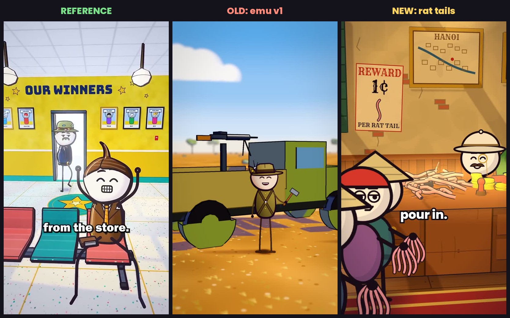
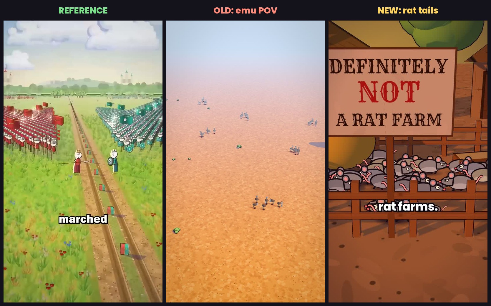
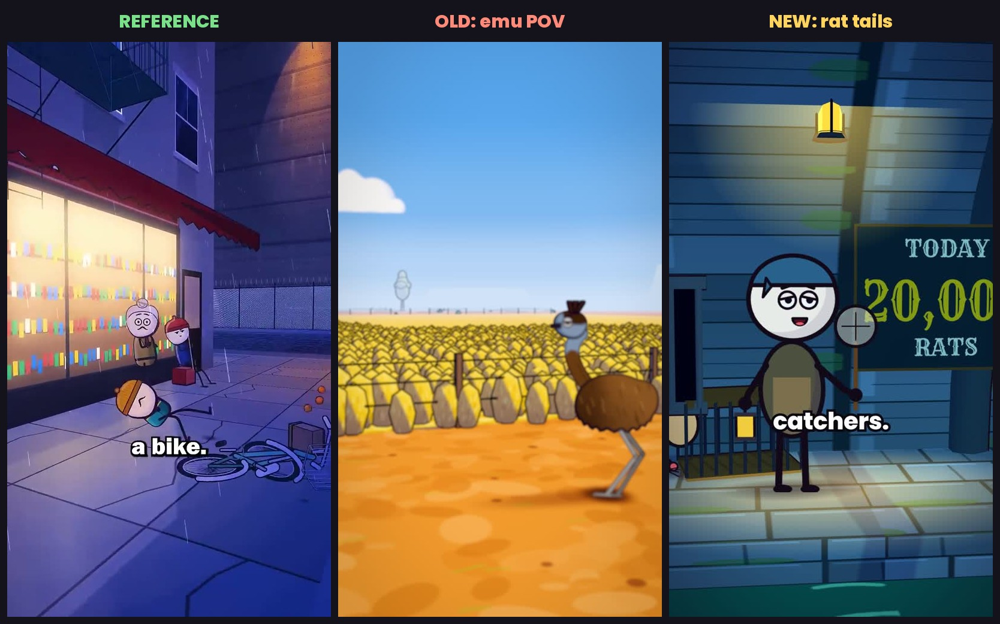
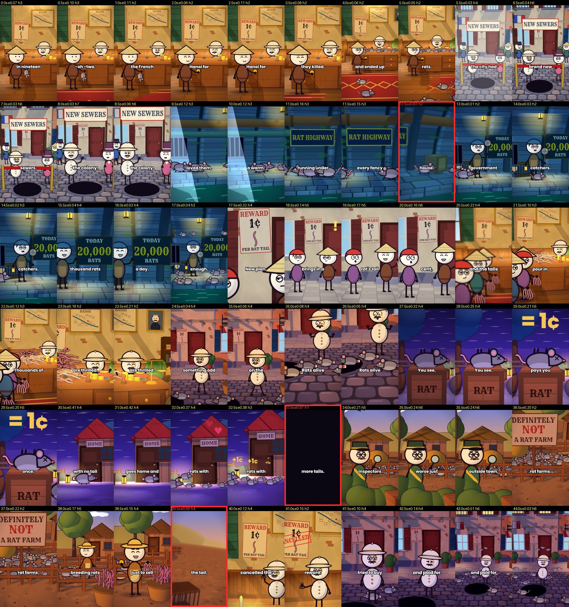

# Proof: "The Rat Tail Problem"

A 44.5 s short made with the stage kit exactly as `SKILL.md` describes: script → Kokoro voice → word timings → shot
list → `plan_lint` → stills → sound → render on Modal (three passes of about 3 minutes each) → `frame_qa` → an
independent reviewer agent → fixes → final render.

- Film: R2 `previews/rat-tails/rat-tails.mp4` (1080x1920, 30 fps, -14.1 LUFS). Source: `studio/src/videos/rat-tails/`.
- Topic: the 1902 Hanoi rat-tail bounty (facts and sources in `studio/src/videos/rat-tails/SCRIPT.md`).

## Side by side

## Measured (`studio/scripts/frame_qa.py`)

| | empty share, median | p90 | sharpness | QA |
|---|---|---|---|---|
| Reference (38 frames) | 0.20 | 0.45 | 189 | pass |
| Emu v1 | 0.45 | 0.65 | 101 | fail |
| Emu POV | 0.56 | 0.67 | 13 | fail |
| **Rat tails** | **0.12** | **0.33** | **174** | **pass** |

The three frames outlined in red are transition frames (two whips and one dip through black).

## What the reviewer said

An independent reviewer agent scored the first full render against the reference: frame density 6/10, character
staging 5, light and colour 7, drawing 6, acting 5, captions 6, with fifteen concrete defects. Twelve were fixed
before the final render (captions clear of the subject, signs fully in frame, the sewer wall, the catcher's colour,
the "rat goes home" beat restaged, the ending pulled closer). The final render has not been re-scored.

## Still short of the reference, honestly

1. **Staging and poses.** Characters mostly stand upright and front-on. The reference stages in depth, at dramatic
   angles, with extreme poses (sprawled, leaning, arms flung). The pose system here has arms, lean, squash and a walk,
   but no bent legs, no sitting, no side view.
2. **Light on the cast.** The 2D characters take one flat tint per mood. In the reference a window or lamp visibly
   lights one side of a character. Props now cast real shadows; characters only have a soft blob.
3. **Surfaces.** Painted textures are procedural and a little uniform. The reference has hand-painted variation and
   richer 3D models (a ship, a vault door).
4. **Voice.** Kokoro is clearer and more natural than the Piper voice of the emu shorts, but it is still a
   synthetic voice without a human narrator's timing on jokes.
5. **Motion was reviewed from stills and contact sheets only.** Nobody has yet watched it against the reference in
   motion, and the reference's motion and sound have not been re-measured from full videos.
