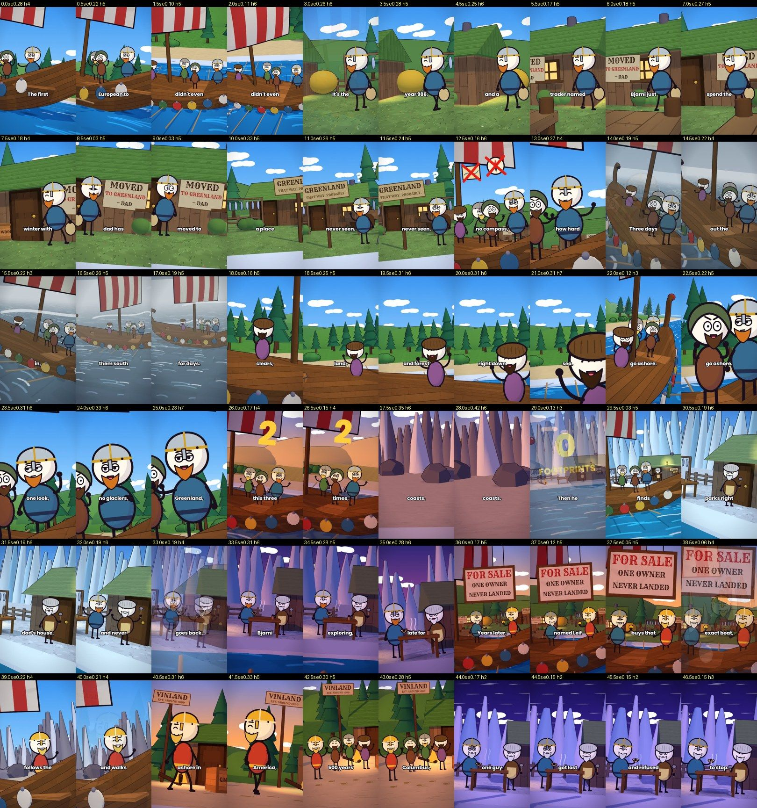

# Proof 2: "Late for Dinner" (the Vikings find America by accident)

A 47 s short on Bjarni Herjolfsson (c. 986), who sighted North America three times while trying to reach Greenland
and never landed. Made with the stage kit after the reference-motion pass (`docs/reference-motion.md`): no hard cuts,
a camera that never stops, low, high and tilted angles, a hook that opens mid-action, two spoken lines with a mouth flap.

- Film: R2 `previews/vikings/vikings.mp4` (1080x1920, 30 fps). Source: `studio/src/videos/vikings/`.
- Facts and sources: `studio/src/videos/vikings/SCRIPT.md`.
- Three renders on Modal, about 3 minutes each.

## Gates (third render)

| Gate | Result |
|---|---|
| `plan_lint.ts` | pass |
| `frame_qa.py` | pass: empty share median 0.21 (reference 0.20), p90 0.31, sharpness 184, 3 moods |
| `audio_qa.py` | pass: -14.0 LUFS, peak -1.5 dB, bed 11.3 dB under the voice, 3.59 words/s, 0.40 s after the last word |

## Reviews

An independent reviewer agent scored each render against the reference (out of 10).

| Render | Density | Staging | Camera | Light | Drawing | Acting | Captions |
|---|---|---|---|---|---|---|---|
| 1 | 5 | 5 | 5 | 6 | 5 | 4 | 6 |
| 2 | 5 | 4 | 5 | 4 | 6 | 5 | 7 |
| 3 | not re-scored | | | | | | |

Render 2's review listed thirteen defects, almost all of one kind: people and signs cut by the frame edge, and a
final frame of two half-faces. Render 3 is a reframing pass that fixes those: the crew is shot along the ship from
the bow and stern, both dinner shots and the last shot hold both men whole, the signs are fully in frame, the "zero
footprints" beat has a lettered card, the second coast is dunes instead of more forest, and the loose roof planks
are gone. The reviewer asked for hard cuts; we kept dissolves because the three full reference videos have none.

## Still short of the reference

1. **Acting.** Poses are arms, lean, squash and a walk. No sitting, bending or full-body gags.
2. **Staging in depth.** Better than render 2, but most shots are still a flat row of figures at mid distance.
3. **Light.** Moods change, but shading on the cast is flat and the fog and dinner shots are low in contrast.
4. **Geography.** The sale is staged at the home harbour; the saga places it in Greenland.
5. **Ice.** Glaciers are jagged cones in two colours, not drawn ice.
6. **Voice.** Synthetic (Kokoro). Clear, but not a performer.
7. **The half second before "zero"** shows bare sand and rocks while the camera waits for the word.
