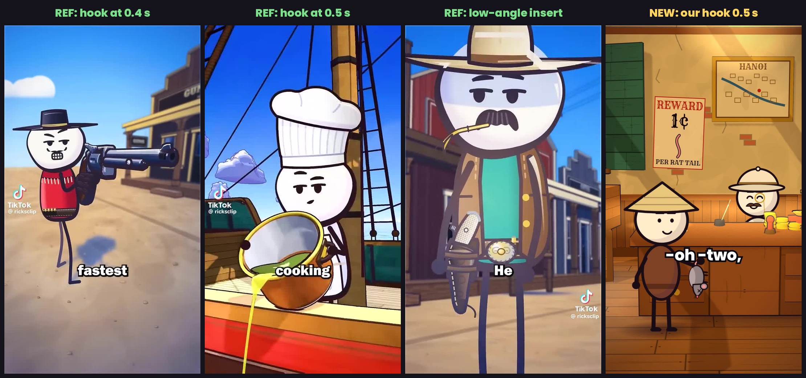

# Reference motion, edit and sound: measured on three full videos

Date: 2026-11-26. Three full reference shorts supplied by the owner (56, 65 and 64 s of content; a western duel, a
railroad, a ship in a storm) were read frame by frame (2 fps sheets of every second, 30 fps strips of 8-16 moments
each, full frames) and measured with scripts. This fills the gap `docs/style-gap-analysis.md` left open: motion,
edit rhythm and sound were until now taken from older notes.

Private study only: nothing here copies their stories, characters, jokes or audio.

## Numbers

| | Reference (3 videos) | Rat tails v3 (before this pass) | Gate now |
|---|---|---|---|
| Hard cuts | 0 | 1 cut, 4 whips, 3 flashes/dips | `plan_lint`: every shot enters by `dissolve` or `move` |
| Place/time change | 6-12 frame cross-dissolve, or the camera follows an object (bullet, oil stream, train), or pushes through something (a pupil, a window, a manhole) | whip / dip / flash | `Stage`: `into: "dissolve"` (8 frames) and `into: "move"` |
| Camera set-ups | 12-15 per 60 s, in 5-8 places | 12 in 5 places | |
| Camera in holds | never fully still: drift on every shot | slow push only | `camera.drift`, always on |
| Camera moves | 20-50 frames, ease-out, no overshoot; fast ones carry motion blur | 8-14 frame bursts | |
| Angles | eye level, low, high, top-down; 8-20 degree tilts on about a third of set-ups; orbits | eye level, front-on | `plan_lint`: low, eye and high all used; a quarter of framings tilted |
| Shot sizes | character from 3-10 % (far wides) to over 100 % (belt, holster, face inserts); 4 prop inserts in one video | 45-65 % throughout | `plan_lint`: at least one `insert` and one `wide` |
| Foreground layer | in nearly every shot (over-shoulder character, rail, post, pot, figurehead) | rare | checklist |
| Hook | frame 0 is the action (gun raised and fired by 0.6 s; oil pouring; rail being sawn) and the camera is already moving | two people standing at a desk, camera still | `plan_lint`: pose changes within 10 frames and camera travels within 15 |
| Characters | flat 2D, facing the lens, front and 3/4 views, one video adds side and top-down; limbs are curved lines; pose changes snap in 1-6 frames; idle bob; blinks | front only, straight limbs | `chars`: curved limbs, `view: "side"`, idle bob helper |
| Character shading | none in two of three (flat, contact shadow only); a whole-figure tint per scene in the third | flat with a tint per mood | no change needed |
| Mouths | flap only on in-character spoken lines: 3 shapes, changing every 3-5 frames. Never under narration | no spoken lines | `chars.talk`, lines pinned to words |
| Script | 1-2 in-character lines per film ("After you."); two of three address the viewer or quote a character | narration only | checklist |
| Captions | 1-2 words (3 at most), white heavy sans, black outline and drop shadow, capital height about 5 % of the frame width, centred at 70 % of the height, hard swap, no pop, no colour | 1-3 words, at 66 %, 2-frame pop | `Captions` defaults; `plan_lint`: under 10 % of chunks longer than 2 words |
| Narration pace | 3.36 / 3.82 / 3.91 words per second; longest pause 0.34-0.54 s | 3.6 | `audio_qa`: 3.3-4.1, no pause over 0.6 s |
| Loudness | -14.2 to -16.7 LUFS (platform re-encodes) | -14.1 | `audio_qa`: -14 +/- 1.5 |
| Music and effects under the voice | 5.5 / 8.9 / 12.2 dB (measured in the gaps between words) | 11.4 | `audio_qa`: 5-12 dB |
| Ending | on the last word, mid-action, no outro (the 4 s tail on two files is the platform's end card) | on the last word | `audio_qa`: under 0.8 s after the last word |
| Light states | 3-4 per film (noon, sunset, lamp-lit interior, night); heavy depth of field in one film, almost none in another | 6 moods | `plan_lint`: 3 or more |

## What did not need changing
- Characters are not shaded by scene light in two of the three films. The first reviewer's "characters unaffected
  by scene light" is not a gap worth chasing.
- Depth of field is a per-film choice in the reference. The kit stays without lens blur.
- Our pace, loudness and bed level were already inside the reference range.

## Still not matched
- "Follow an object" transitions between places (the camera riding a bullet from one character to another). The kit
  has the manhole push-through and same-place camera travel, but no object-following helper.
- Top-down drawings of characters, and a jointed walk cycle with 6 frames per step. The side view here is a profile
  head on the front body.
- Motion blur on fast camera moves.
- Orbits around a character (the cast is flat cards, so an orbit only works for small angles).
