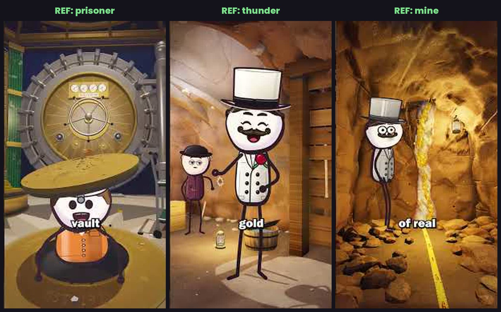
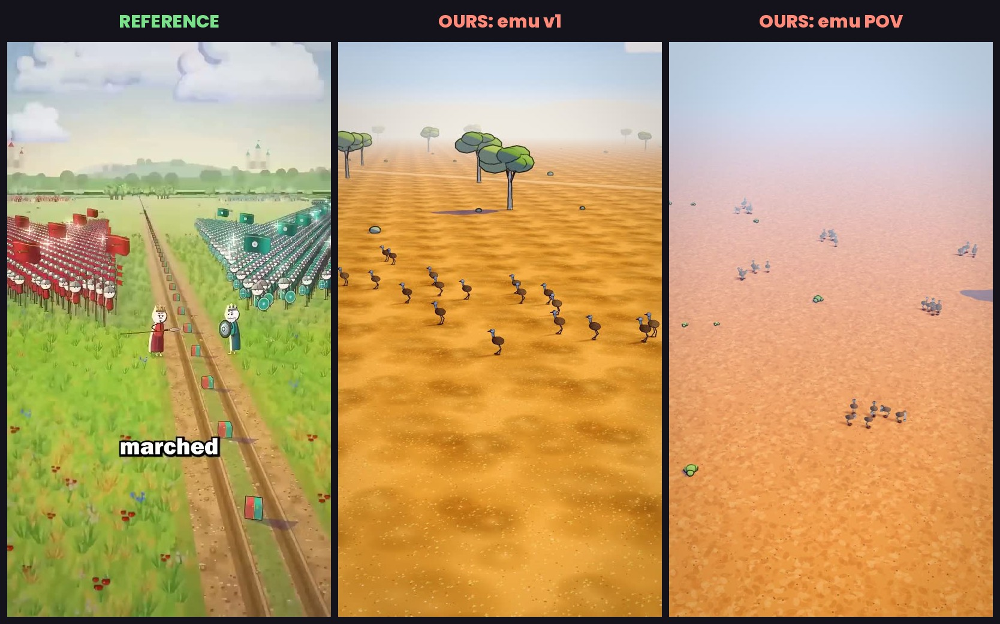
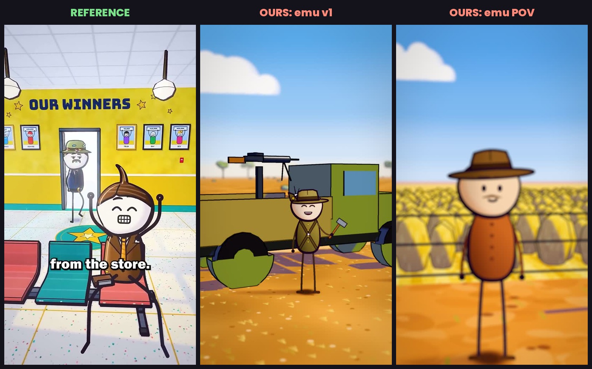
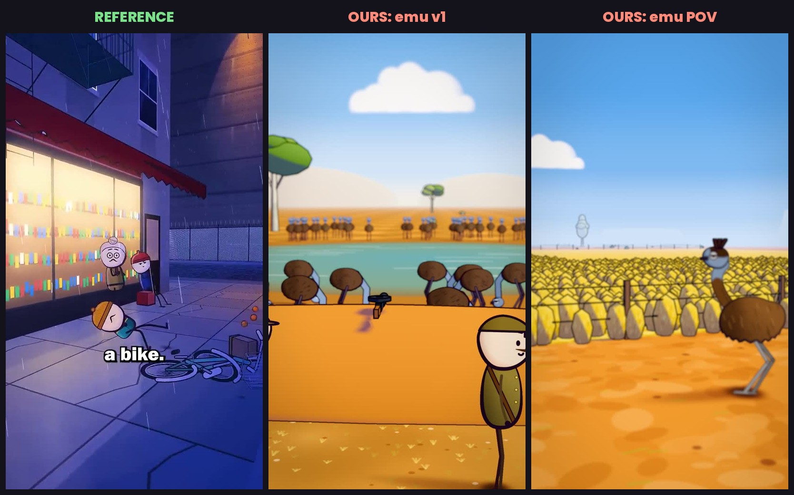

# Style gap analysis: the reference channel vs our two Emu War shorts

Date: 2026-11-26. Scope: why the two "Emu War" shorts made with this repo's cartoon-short skill do not reach the
reference channel's quality and style, root cause by root cause, and what was changed in the repo because of it.

## What was compared

| | Material | How it was looked at |
|---|---|---|
| Reference | 1,238 real frames of the channel's shorts already in this repo: `references/sheets/` (20 shorts, 60 frames each at 30 fps) and `references/frames/` (38 full frames), plus the measured reports in `references/reports/` and `references/STYLE_BIBLE.md` | contact sheets and full frames read one by one; `studio/scripts/frame_qa.py` on the 38 full frames |
| Emu v1 | `previews/emu-war/emu-war.mp4` (R2), 1440x2560, 61.0 s | 2 frames/s contact sheets (122 frames), full frames, `frame_qa.py`, ebur128 loudness |
| Emu POV | `previews/emu-war-pov/emu-war-pov.mp4` (R2), 1080x1920, 68.5 s; source `examples/emu-war/` on branch `claude/blissful-brown-ahjkws` | same, plus its `story.ts`, `world.ts`, README |

| Reference, latest | 9 real frames (25/50/75 %) of three of the channel's latest Shorts the owner linked: "The Prisoner Who Tunneled Into a Bank", "Why Samurai Feared The Flying Thunder", "How Mine Salting Worked" (`docs/img/ref3/`, fetched with the Sitefarm `scout_frames` tool) | read one by one |

What the latest three add to the picture: the main character is even bigger than in the older set (half the frame
height or more, centred), every set is an interior or a night scene with a visible light source (cell window, tent
lamps, mine lantern), props cast real shadows, and the caption is small (about 6 % of the frame width per letter
height), white, one or two words.

**Limits of this analysis, stated plainly.**
- The channel's latest Shorts could not be downloaded from the build machine (YouTube's bot check refused every
  player client tried, and no mirrors exist). The picture analysis therefore uses the reference frames this repo
  already held (the channel's 20 latest shorts as of 2026-10-30) plus nine still frames of three of the latest
  Shorts. Those nine are low-resolution (203x360) and show no motion.
- Reference **sound and motion** were not re-measured: the numbers quoted for them come from the measured study in
  `references/STYLE_BIBLE.md` and `references/reports/motion.md` (made from the real videos), not from new listening.
- The source of Emu v1 lives in another repository that could not be attached, so its code was not read; its picture
  and sound were analysed from the MP4.

## The gap in three pictures

Measured with `studio/scripts/frame_qa.py` (share of the frame with no drawn detail, and sharpness of the sharpest third):

| | empty share, median | frames more than 55 % empty | sharpness, median |
|---|---|---|---|
| Reference (38 frames) | **0.20** | 3 of 38 | 189 |
| Emu v1 | 0.45 | 30 of 137 | 101 |
| Emu POV | 0.56 | 62 of 122 | **13** |
| New short (rat tails) | see `docs/proof-rat-tails.md` | | |

## Frame-by-frame findings

### Drawing
- **Reference:** characters are big in the frame (a third to two thirds of its height), heads are off-white beans a
  third of the body height with eyes almost touching, thick plum outlines, stick limbs with ink-dot hands. Every
  character holds or wears something specific (chef's hat, ladle, striped shirt, lottery ticket). Props are detailed
  and *lettered*: "OUR WINNERS", "STORM OIL", "CARCASS / KEEP FROM FLAME", "SPIN". The sets are real 3D with
  perspective (tiled ceilings, a ladder shot from below, a slot machine in close-up).
- **Ours:** the character drawing itself is close (the bridge look-match work paid off: bean heads, plum ink, lidded
  eyes). What is wrong is everything around it. Characters are often 10-20 % of the frame height, alone, in the middle
  of a bare plane. Props are raw primitives: the truck in Emu v1 is three flat-coloured boxes and two cylinders, the
  truck bed a flat olive wall. No object in either film carries a single written word.

### Colour and light
- **Reference:** three to five light moods per short, each tied to a story beat: noon, storm, a night-blue sea, a warm
  lamp-lit galley, a neon-lit rainy alley. Light sources are visible (windows, lamps, shop fronts) and throw pools that
  tint the cast. Darks are deep (p2 luma 0.03-0.11).
- **Ours:** one outback-noon look for 80 % of both films, then one golden look. Sky is a flat blue gradient with two
  or three white clouds, ground a single orange texture. No light source ever appears in frame. Emu v1 has a visible
  texture-tiling moiré on the ground in every aerial shot.

### Depth
- **Reference:** soft lens blur on about a third of screen time, always behind a sharp subject.
- **Ours:** Emu POV blurs *the subject*: in the opening shot both soldiers and the gun are out of focus and the sharp
  plane holds nothing; its median sharpness is 13 against the reference's 189. `examples/emu-war/src/emu/story.ts:197`
  sets blur on 26 of 36 shots.

### Animation
- **Reference:** characters hold a pose and change it sharply on the word; props move (ladles pour, coins fly, ships
  roll); crowds fill the frame. Effects are flat 2D sprites (sparkles, splashes, speed lines).
- **Ours:** walk cycles and blinks are fine. But poses are rarely *acted*: characters stand with arms down. Almost
  nothing in the world moves besides the cast.

### Editing and pacing
- **Reference (measured, STYLE_BIBLE.md:35-39):** hard cuts almost never (0-1 per video in 12 of 20); the camera holds
  about 80 % of the frames and moves in ease-out bursts; place changes are whips, fly-throughs or 6-8 frame dissolves.
- **Ours:** Emu POV has 36 shots in 61 s, 30 of them hard cuts (the `SHOTS` and `XFADE` tables in `story.ts`), with a smootherstep glide inside each
  and a constant creep. That is the opposite rhythm: the reference feels like one continuous take, ours like a slideshow.

### Text and captions
- **Reference:** a caption on every word: one to three words, bold white sans with a black outline, lower-middle, hard
  swaps. It is on screen 100 % of the time and is a big part of the look.
- **Ours:** none. The skill forbids them (`SKILL.md:19`: "No captions or labels in the video").

### Sound
- **Reference (measured, STYLE_BIBLE.md:6-8):** one human male narrator, 3.5-4.1 words/s, almost no pauses, -14 LUFS,
  music and effects only 5-10 dB under the voice.
- **Ours:** loudness is right (-14.1 and -14.5 LUFS). The voice is Piper TTS (`examples/emu-war/README.md`): clearly
  synthetic, with flat prosody. All effects are synthesized from noise and sine waves (`templates/audio/sfx_gen.py`),
  which is fine for creaks and thuds but thin for animals, crowds and coins.

### Story and hook
- **Reference:** the first frame already shows the paradox with the main character large in frame; every sentence is
  illustrated literally and the props carry the joke.
- **Ours:** the scripts follow the formula well (the emu scripts are the strongest part). But the first two seconds of
  both films are a small, partly blurred figure behind a fence on an empty plain.

## Root causes

1. **The template is one finished film, not a kit.** `SKILL.md:83` says "Start every new short from `templates/bridge/`".
   That folder is 5,000 lines hard-wired to one bridge in one town (`world.ts`, `build.ts`, `cast.ts`). A new topic means
   rewriting the world and the cast from scratch, so the agent spends its effort on plumbing and has none left for set
   dressing. There is no prop library, no set builder, no lettering helper.
2. **The 3D assets the look depended on are not in the repo.** The bridge world loads Kenney CC0 models from
   `public/bridge/kenney/*.glb` (`templates/bridge/world.ts:24`, `SKILL.md:57`), about 1.3 GB that were never committed.
   The emu session replaced `loadKit` with an empty stub (`examples/emu-war/src/emu/world.ts:15`) and built trucks,
   guns and houses out of boxes.
3. **The skill has no rule about how full a frame must be**, and no check for it. `templates/scripts/short_qa.py` only
   looks for black, white, frozen and popping frames and loudness. A film that is 56 % empty ground passes.
4. **Captions are forbidden** (`SKILL.md:19`, `references/STYLE_BIBLE.md:10`), although the repo's own study lists them
   as part of the format.
5. **The camera rules contradict the repo's own measurements.** `SKILL.md:103` and `:118-119` prescribe "cuts on big
   jumps", 18-40 frame smootherstep glides and "every hold creeps"; `STYLE_BIBLE.md:35-39` measured almost no cuts,
   80 % holds and 8-10 frame ease-out bursts.
6. **Only two light presets exist** (`templates/bridge/lights.ts:15`: day, golden; the shot type in `SKILL.md:46`
   allows nothing else). The reference's night, storm and interior moods cannot be expressed.
7. **Lens blur is treated as a per-shot dial with no guard.** `SKILL.md:99` gives blur sizes per shot type but nothing
   checks that the focus plane holds the subject.
8. **The pipeline needs a GPU that sessions do not have.** The look is built from post passes (ink, lens blur, bloom,
   grade, MSAA 4). On a CPU-only cloud machine that is 11-20 s per frame at 540x960
   (`examples/emu-war/README.md`), so the first Emu POV was rendered at quarter size and upscaled, and stills were too
   slow to iterate on. Measured here: 7.6 s per frame at 1080x1920 with every post pass *off*.
9. **The review step is optional and expensive.** `SKILL.md:25,74` ask for an "Opus max verifier" on stills, by hand.
   Nothing in the scripts forces a look at the whole film as a contact sheet before delivery, so "improvised" staging
   (characters small, arms down, nothing in the hands) went out unchallenged.
10. **Voice and effects quality were left to whatever was at hand** (`SKILL.md:42`: "Record or generate"). Piper was
    the first thing that installed.

## What changed in the repo because of this

See `SKILL.md` (rewritten), `docs/style-rules.md`, `docs/rendering.md` and `studio/`.

| Root cause | Fix |
|---|---|
| 1, 2 | `studio/src/stage/`: a film-agnostic engine. `props.ts` (50+ inked, painted props, no external models), `sets.ts` (room, street, tunnel, field), `paint.ts` (surfaces and lettered signs), `chars.ts` (people with hats, held props, 9 mouths, 8 eye types; rats). A film is now two files: sets and a shot list. |
| 3, 7, 9 | Two deterministic gates. `studio/scripts/plan_lint.ts` reads the shot list and, without rendering, fails a cast under 30 % of the frame height, a face under the caption, a shot where nothing changes, too many plain cuts, fewer than three moods. `studio/scripts/frame_qa.py` measures the rendered film: empty-frame share, sharpness, palette, moods, with a marked contact sheet. Both are required before delivery. |
| 4 | `studio/src/stage/Captions.tsx`: word-by-word captions from `words.json`, on by default. |
| 5 | `studio/src/stage/camera.ts`: `track()` = hold + ease-out burst, `whip()` and dip/flash transitions; hard cuts are the exception. |
| 6 | `studio/src/stage/moods.ts`: seven light moods (day, golden, dusk, night, sewer, interior, explain); lamps and windows throw visible pools. |
| 8 | No post-processing passes: inverted-hull ink, painted textures, shadow-mapped key light, CSS grade. Full 1080x1920 on four CPU cores at about 3 s per frame, stills in about 5 s; the same project renders on Modal in parallel chunks (`docs/rendering.md`). |
| 10 | `studio/audio/`: Kokoro neural voice, pauses tightened to the reference's pace; CC0 recorded effects from Freesound with a credits file; the synthesized score stays. |
